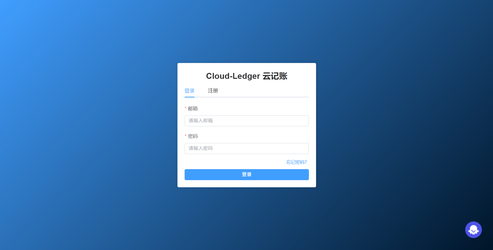
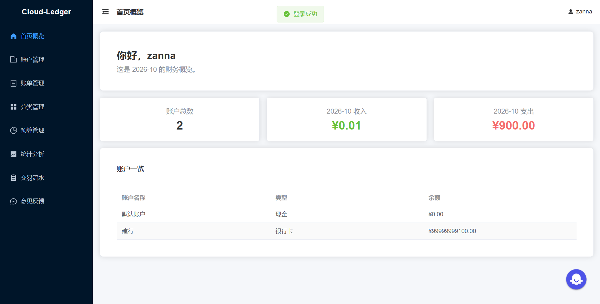
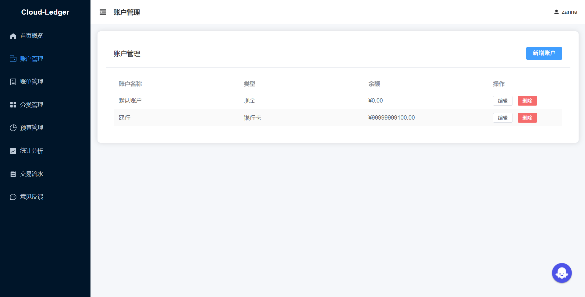
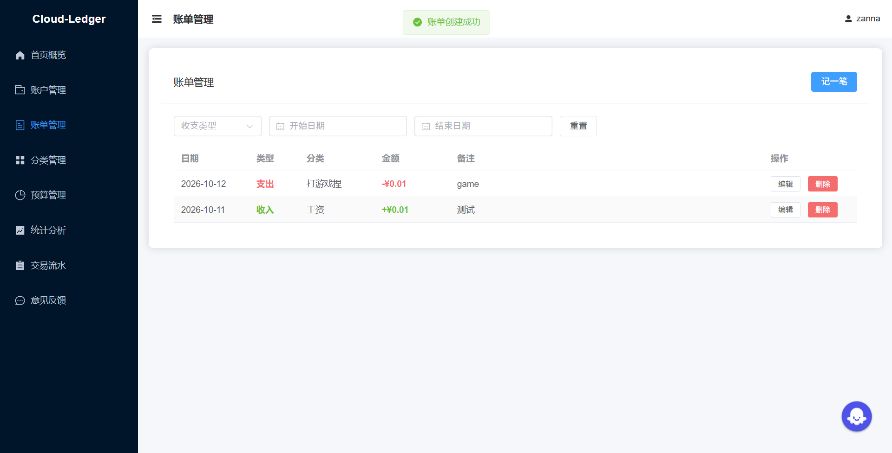
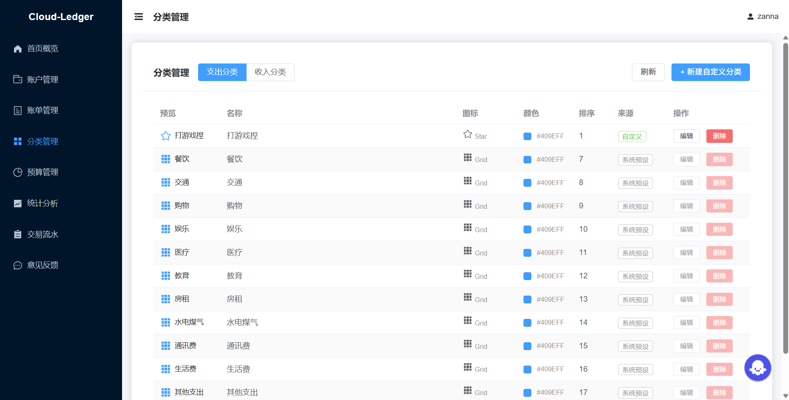
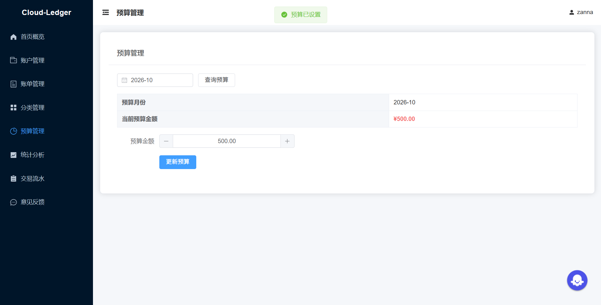
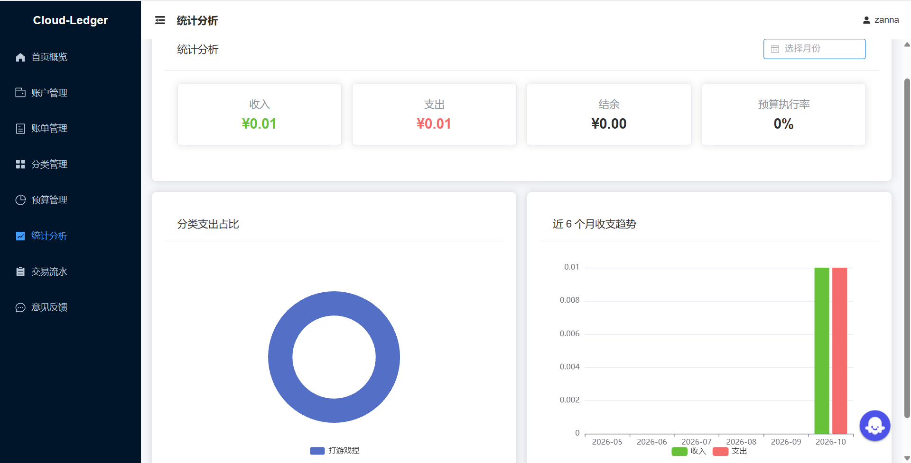
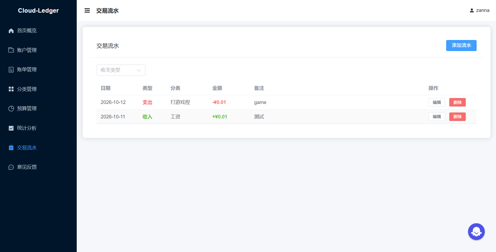
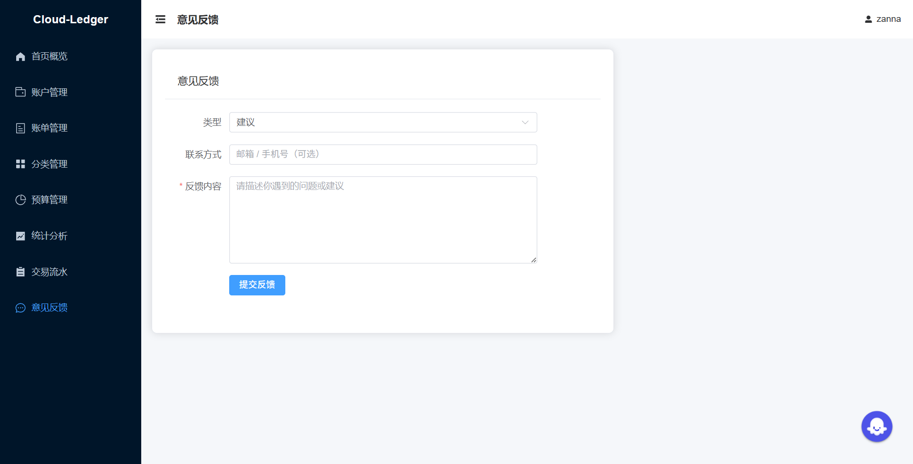
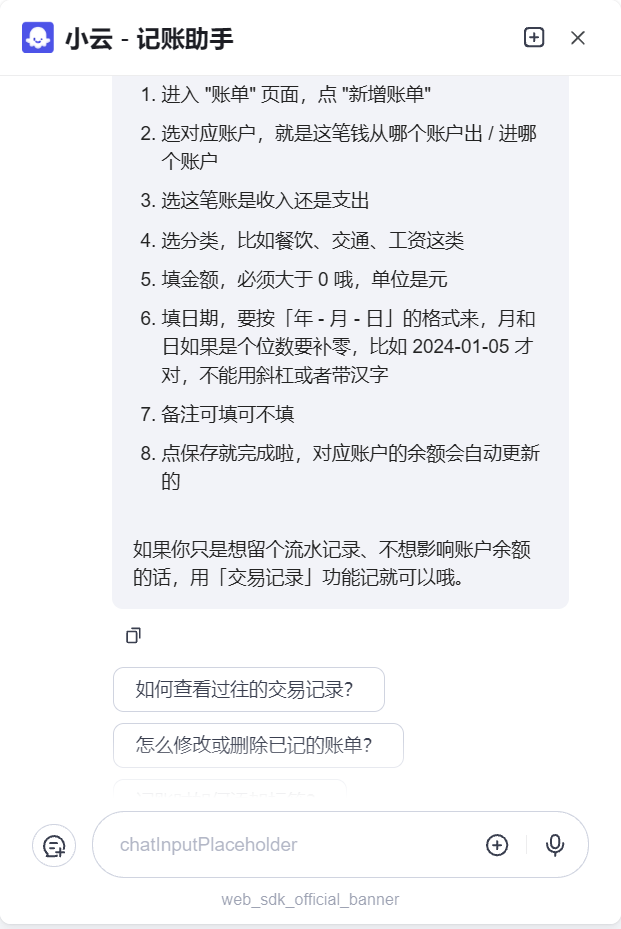

# Cloud-Ledger · 云记账

> 个人与家庭级的全栈式在线记账系统

---

## 一、项目简介

### 背景与价值

随着个人资产管理需求的增长，传统的电子表格记账方式在数据一致性、多终端访问、自动统计等方面存在明显短板。Cloud-Ledger 云记账旨在提供一套**安全、易用、可视化**的在线记账解决方案，让用户能够在一个统一的平台上完成日常收支记录、多账户资产管理、预算规划与财务分析。

### 目标用户

- 需要管理工资、奖金、投资收益等多来源收入的**个人用户**
- 持有现金、银行卡、支付宝、信用卡等多账户、需实时查看总资产的**家庭用户**
- 希望通过月度预算控制支出、优化消费结构的**理财人群**

### 核心特性

- **多账户管理**：账单增删改自动回写账户余额，事务级原子联动
- **两级预算体系**：月度总预算 + 分类细分预算，剩余额度实时计算
- **数据可视化**：月度收支汇总、近 6 月趋势图、分类占比饼图（ECharts）
- **安全鉴权**：JWT 无状态鉴权 + Redis 黑名单 + bcrypt 密码哈希 + 忘记密码邮箱验证码
- **接口幂等**：全接口 `CREATE TABLE IF NOT EXISTS` / `INSERT IGNORE`，重复请求不报错
- **一键部署**：Docker Compose 编排 MySQL / Redis / Backend / Frontend 四服务

---

## 二、技术栈

### 后端

| 组件 | 版本 | 说明 |
|---|---|---|
| Java | 17 | LTS |
| Spring Boot | 3.2.5 | Web / Security / Validation / Data Redis / Actuator / Mail |
| MyBatis Plus | 3.5.5 | ORM（Spring Boot 3 Starter） |
| MySQL | 8.0.43 | 主数据库（DDL 见 `src/main/resources/sql/schema.sql`） |
| Druid | 1.2.23 | 连接池 + 监控台（dev 开放 / prod 关闭） |
| Redis | 7.x | 会话续期、JWT 黑名单、业务缓存 |
| jjwt | 0.12.5 | JWT 签发与校验 |
| SpringDoc OpenAPI | 2.3.0 | OpenAPI 3 文档生成 |
| Knife4j | 4.5.0 | Swagger UI 增强（`http://localhost:8080/doc.html`） |
| Lombok | — | 简化实体 / Service 编码 |
| Maven | 3.9+ | 构建工具 |

### 前端

| 组件 | 版本 | 说明 |
|---|---|---|
| Vue | 3.4.21 | 渐进式 JS 框架 |
| Vite | 5.2.8 | 构建工具（别名 `@`、手动分包） |
| Element Plus | 2.7.6 | UI 组件库（中文 locale） |
| Pinia | 2.1.7 | 状态管理（user token / localStorage 持久化） |
| Vue Router | 4.3.0 | Hash 路由 + 登录守卫 |
| Axios | 1.6.8 | HTTP 客户端（拦截器 + 统一错误处理） |
| ECharts | 5.5.0 | 可视化（统计卡片、趋势柱状图、分类饼图） |

### 测试与部署

| 组件 | 说明 |
|---|---|
| JUnit 5 + MockMvc | 集成测试（覆盖 8 大模块，连接真实 MySQL + Redis） |
| Docker | 多阶段镜像（后端 JDK17 / JRE 17 + 前端 nginx） |
| docker-compose | MySQL / Redis / Backend / Frontend 四服务一键编排 |
| Nginx | 前端静态托管 + `/api` 反向代理至后端 |

---

## 三、功能说明

系统按职责划分为 8 个核心业务模块，后端 9 个 Controller + 前端 8 个页面一一对应。

```
┌────────────────────────────────────────────────────────────────────────┐
│                         Cloud-Ledger 云记账                           │
├──────────────┬──────────────┬──────────────┬──────────────────────────┤
│  用户认证     │  账户管理     │  账单管理     │  交易流水管理            │
│  Auth        │  Account     │  Bill        │  Transaction            │
│  /api/auth/* │  /api/accounts│  /api/bills  │  /api/transactions      │
├──────────────┼──────────────┼──────────────┼──────────────────────────┤
│  预算管理     │  分类管理     │  数据分析     │  用户反馈                │
│  Budget      │  Category    │  Report      │  Feedback               │
│  /api/budgets│  /api/categories│  /api/reports│ /api/feedback          │
└──────────────┴──────────────┴──────────────┴──────────────────────────┘
```

### 各模块职责

| 模块 | 后端 Controller | 前端页面 | 核心职责 |
|---|---|---|---|
| **用户认证** | `AuthController`、`PasswordController` | `LoginView`、`ForgotPasswordView`、`MainLayout` | 注册 / 登录 / 登出 / JWT 鉴权；新用户自动创建默认现金账户；bcrypt 密码哈希；忘记密码（邮箱验证码 + 5 次错误作废 + 防账户枚举）；登录态修改密码（当前 Token 拉黑 + 旧 Token 全部失效） |
| **账户管理** | `AccountController` | `AccountView` | 多账户 CRUD；关联用户唯一约束；删除时级联清除账单与预算 |
| **账单管理** | `BillController` | `BillView` | 收支记录增删改查；账单与账户余额**双向联动**（新增扣减 / 变更回滚 / 删除恢复）；支持日期区间 + 分类筛选 |
| **交易流水** | `TransactionController` | `TransactionView` | 与账单共用 `bill` 表但 `account_id` 可空；写入**不联动账户余额**，用于独立流水记录 |
| **预算管理** | `BudgetController` | `BudgetView` | 按月 + 分类（可空=总预算）设定预算金额；查询剩余额度；动态 upsert |
| **分类管理** | `CategoryController` | `CategoryView` | 预设 6 收入 + 11 支出分类（幂等种子数据）；支持用户自定义分类；后端统一管理 |
| **数据分析** | `ReportController` | `DashboardView`、`ReportView` | 月度总收入 / 支出 / 结余；近 6 月趋势（柱状图）；分类占比（饼图）；预算执行情况 |
| **用户反馈** | `FeedbackController` | `FeedbackView` | 已登录用户提交 Bug / 建议反馈；`@PreAuthorize` 强制鉴权 |

### 模块联动关系

- **账单 ↔ 账户**：账单新增/更新/删除时触发余额原子变更（`BigDecimal` + `UPDATE account SET balance = balance + ?`），事务保护
- **预算 ↔ 账单**：预算执行情况实时从 `bill` 表聚合 `SUM(amount)`（type=expense）计算，不存冗余字段
- **分类 ↔ 账单/预算**：分类为字典模块，账单与预算通过 `category` 字符串字段引用，不建外键以提升查询灵活性

---

## 四、界面展示

以下截图均为系统实际运行效果，反映真实的功能界面与交互状态。

### 4.1 登录页



深蓝渐变背景 + 居中白色登录卡片，支持登录/注册 Tab 切换。表单包含邮箱、密码两个必填项，底部提供"忘记密码"链接。右下角悬浮 AI 客服入口，可随时调起智能助手。

### 4.2 首页概览



登录后进入工作台首页，顶部显示用户问候与当前月份。页面核心为三张统计卡片（账户总数、当月收入、当月支出），收入用绿色、支出用红色直观区分。下方"账户一览"表格汇总展示所有账户名称、类型与余额。

### 4.3 账户管理



支持多账户 CRUD（现金、银行卡等类型）。表格列出账户名称、类型、余额，每行提供编辑/删除操作。右上角蓝色"新增账户"按钮快速创建新账户。删除时级联清除关联账单与预算。

### 4.4 账单管理



记账核心页面，支持按收支类型、日期区间筛选。表格展示日期、类型（收入绿色/支出红色）、分类、金额（带±号）、备注、操作。每条账单与账户余额**双向联动**——新增扣减、变更回滚、删除恢复，全程事务保护。顶部"记一笔"按钮快速新增账单。

### 4.5 分类管理



收支分类双 Tab 切换，预设 11 个支出分类 + 6 个收入分类（系统预设，不可删除），同时支持用户自定义分类（可编辑/删除）。表格展示分类预览图标、名称、颜色、排序、来源标识（绿色"自定义"/灰色"系统预设"）。右上角"新建自定义分类"按钮扩展个性化分类。

### 4.6 预算管理



按月设定预算金额，支持月份选择器查询历史预算。页面显示当前预算月份与金额，通过数字步进器调整额度，点击"更新预算"即时生效。预算执行情况实时从账单表聚合计算，不存冗余字段。顶部绿色"预算已设置"标识当前状态。

### 4.7 统计分析



数据分析核心页面，顶部四张 KPI 卡片（收入、支出、结余、预算执行率）。下方双图并列：左侧环形饼图展示分类支出占比，右侧柱状图展示近 6 个月收支趋势（绿色收入/红色支出）。支持按月份切换查看历史数据。图表基于 ECharts 渲染。

### 4.8 交易流水



独立流水记录页面，与账单共用数据表但 `account_id` 可空，写入**不联动账户余额**。适合记录不需影响账户余额的独立流水。表格结构与账单管理一致，支持收支类型筛选。右上角"添加流水"按钮快速记录。

### 4.9 意见反馈



已登录用户提交 Bug 报告或功能建议。表单包含类型下拉（Bug/建议）、联系方式（可选）、反馈内容（必填），点击"提交反馈"完成提交。`@PreAuthorize` 注解强制鉴权，未登录用户无法访问。

### 4.10 AI 客服



全站右下角悬浮 AI 记账助手「小云」，点击即可调起对话窗口。助手基于项目知识库回答产品功能、操作流程与常见问题——例如逐步指导如何记一笔账单（选账户 → 选收支类型 → 选分类 → 填金额与日期 → 保存后余额自动联动），并给出"如何查看过往交易记录""怎么修改或删除已记的账单"等引导问题，帮助新用户快速上手。

---

## 五、使用指南

### 5.1 环境要求

| 依赖 | 版本 | 备注 |
|---|---|---|
| JDK | 17+ | 推荐 Temurin / Oracle OpenJDK |
| Maven | 3.9+ | Windows 用户将本地仓库路径加入 `settings.xml` |
| Node.js | 18+ | 推荐 LTS |
| npm | 9+ | 或使用 pnpm / yarn |
| MySQL | 8.0+ | 库名 `cloud_ledger`（`schema.sql` 会自动创建） |
| Redis | 7.x | 默认端口 6379 |
| Docker & Compose | 24+ / 2+ | （可选，一键部署） |

### 5.2 配置准备

编辑 `src/main/resources/application-dev.yml`（**敏感信息唯一载体**）：

```yaml
cloud-ledger:
  datasource:
    url: jdbc:mysql://localhost:3306/cloud_ledger?useUnicode=true&characterEncoding=utf8&serverTimezone=Asia/Shanghai&useSSL=false&allowPublicKeyRetrieval=true
    username: root
    password: "你的MySQL密码"
  redis:
    host: localhost
    port: 6379
    password: ""   # Redis 未设置密码则留空
  jwt:
    secret: "至少32字节的随机字符串"
  # 邮箱 SMTP（忘记密码验证码发信，必须填写后才能真实发信）
  # QQ 邮箱：host=smtp.qq.com port=465(SSL)，password 填「设置→账户→POP3/SMTP 服务」生成的授权码（非登录密码）
  # 163 邮箱：host=smtp.163.com port=465(SSL)，password 同样填写客户端授权码
  # 587 端口：将 ssl-enable 置 false、starttls-enable 置 true
  mail:
    host: "smtp.qq.com"
    port: 465
    username: "yourname@qq.com"   # 发件邮箱完整地址
    password: "授权码"            # 邮箱服务商生成的 SMTP 授权码
    ssl-enable: true
    starttls-enable: false
```

> 忘记密码功能依赖 SMTP 真实发信；未配置时 `POST /api/password/forgot/code` 返回 503。

> `application.yml` 通过 `${cloud-ledger.*}` 占位符引用，**请勿直接修改**。

### 5.3 启动方式

#### 方式 A：本地开发（后端 + 前端分开启动）

```bash
# 1. 启动 MySQL（确保 schema.sql 已执行，或让 Spring Boot 自动初始化）
mysql -u root -p < src/main/resources/sql/schema.sql

# 2. 启动 Redis
# Windows：在 redis 安装目录执行 redis-server

# 3. 后端（8080）
mvn spring-boot:run
# 看到 "Cloud-Ledger 云记账系统启动成功!" 即成功
# API 文档：http://localhost:8080/doc.html
# 健康检查：curl http://localhost:8080/

# 4. 前端（5173，Vite dev server 自动代理 /api → 后端）
cd cloud-ledger-ui
npm install
npm run dev
# 浏览器访问 http://localhost:5173
```

#### 方式 B：Docker Compose 一键部署

```bash
# 项目根目录（含 docker-compose.yml）
docker compose up -d --build

# 服务访问
# 前端：http://localhost/
# 后端 API：http://localhost:8080/api
# API 文档：http://localhost:8080/doc.html
```

Compose 编排会自动拉起 `mysql / redis / backend / frontend` 四服务，并按依赖顺序初始化。

#### 方式 C：后端打包独立运行

```bash
mvn clean package -DskipTests
java -jar target/cloud-ledger.jar
```

### 5.4 基本操作流程

1. **打开系统**：访问前端首页，进入登录页
2. **注册新用户**：填写邮箱、用户名、密码（≥ 8 位，含大小写字母 + 数字），提交后系统自动创建一个默认现金账户
3. **登录**：输入邮箱与密码，登录成功后自动跳转至工作台首页
4. **添加账户**：进入「账户管理」，创建现金、银行卡、支付宝、信用卡等多类型账户并记录余额
5. **记账**：进入「账单管理」，选择账户 → 收支类型 → 分类 → 金额 → 日期 → 提交；**账户余额实时联动**
6. **设预算**：进入「预算管理」，按月/分类设定预算金额，系统实时显示已支出 / 剩余额度
7. **看报表**：进入「统计分析」，查看月度汇总、6 月趋势柱状图、分类支出占比饼图
8. **提交反馈**：进入「意见反馈」，选择类型（Bug / 建议），提交意见

### 5.5 运行测试

```bash
# 后端集成测试（连接真实 MySQL + Redis）
mvn test
# 输出末尾包含：【汇总】 X/X 用例通过

# 前端生产构建（验证依赖 + 打包产物）
cd cloud-ledger-ui
npm run build
# 产物位于 cloud-ledger-ui/dist/
```

### 5.6 常见问题

| 问题 | 原因 | 解决 |
|---|---|---|
| 启动时数据库报错 `Unknown database 'cloud_ledger'` | MySQL 中尚未建库 | 执行 `schema.sql`（Spring Boot 配置了自动初始化，默认会执行） |
| Redis 连接失败 `Unable to connect` | Redis 未启动 | 启动 `redis-server`，或在 `application-dev.yml` 关闭 Redis 依赖 |
| 登录返回 401 | JWT 过期或 token 被吊销 | 退出重登；若持续出现检查服务器时间漂移 |
| 前端 `npm install` 很慢或超时 | npm 官方源不稳定 | 使用国内镜像：`npm config set registry https://registry.npmmirror.com` |
| Docker 构建失败 `docker: command not found` | Docker 未安装或未启动 | 安装 Docker Desktop 并确保已启动 |
| Knife4j 文档页打不开 `/doc.html` | 被 Spring Security 拦截 | 确认 `SecurityConfig` 已放行 `/doc.html`、`/v3/api-docs/**`、`/webjars/**` |
| MySQL `PublicKey Retrieval is not allowed` | MySQL 8 默认加密方式变更 | 在 datasource URL 追加 `allowPublicKeyRetrieval=true`（`application-dev.yml` 已配置） |
